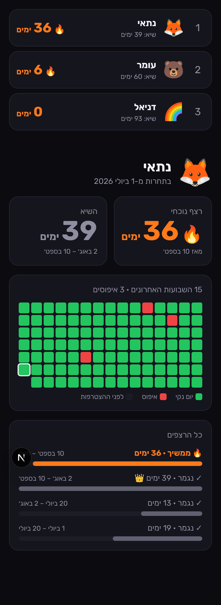

# 🔥 Streak Club

תחרות פרטית בין חברים: מי מחזיק הכי הרבה ימים בלי לפתוח את האפליקציה.
כל פתיחה שלה באייפון מאפסת את הרצף אוטומטית, דרך אוטומציה של אפליקציית קיצורים.



- **לוח מובילים:** הרצף הנוכחי של כל אחד, השיא שלו, ושיא הקבוצה.
- **היסטוריה:** לוח שנה של 15 שבועות, כל הרצפים, ורצפים שעדיין רצים (🔥) מסומנים בנפרד מרצפים שנגמרו (✓).
- **בלי App Store:** אפליקציית ווב (PWA) שמוסיפים למסך הבית.

**הטכנולוגיות:** Next.js 16 על Vercel, ו-Supabase (Postgres, התחברות עם קוד במייל, RLS).

## איך זה עובד

```
iPhone Shortcut ("When <app> is opened") ──POST──▶ /api/report/<token> (Vercel)
                                                        │ rpc report_open(token)
                                                        ▼
                                                  Supabase Postgres
```

- כל משתמש מקבל קישור סודי משלו (`report_token`).
- כמה פתיחות באותו יום נספרות כאיפוס אחד. היום נקבע לפי שעון ישראל.
- הרצפים לא נשמרים בטבלה. הם מחושבים מרשימת האיפוסים בקובץ `lib/streaks.ts`.
- רק מי שהצטרף עם קוד ההזמנה רואה נתונים. זה נאכף ב-RLS בקובץ `supabase/migrations/0001_init.sql`.

## התקנה (פעם אחת, כ-15 דקות)

### 1. Supabase
1. יוצרים פרויקט חדש ב-[supabase.com](https://supabase.com). אזור מומלץ: Frankfurt.
2. ב-**SQL Editor** מדביקים ומריצים את כל התוכן של `supabase/migrations/0001_init.sql`.
3. קובעים קוד הזמנה:
   ```sql
   update club_settings set invite_code = 'הקוד-שלכם';
   ```
4. ב-**Authentication → Email Templates → Magic Link** מחליפים את גוף המייל בטקסט הבא, כדי שיישלח קוד ולא קישור:
   ```html
   <h2>הקוד שלך ל-Streak Club</h2>
   <p style="font-size:32px;letter-spacing:6px"><b>{{ .Token }}</b></p>
   ```
5. ב-**Project Settings → API** מעתיקים את ה-Project URL ואת ה-Publishable key.

> לשרת המייל המובנה של Supabase יש מגבלה של כמה מיילים בשעה. לקבוצה קטנה זה מספיק, כי כל אחד מתחבר פעם אחת. אם צריך יותר, אפשר לחבר SMTP חיצוני (למשל Resend) ב-Authentication → SMTP.

### 2. Vercel
1. ב-[vercel.com/new](https://vercel.com/new) מייבאים את הריפו הזה.
2. מגדירים Environment Variables:
   - `NEXT_PUBLIC_SUPABASE_URL`
   - `NEXT_PUBLIC_SUPABASE_PUBLISHABLE_KEY`
3. לוחצים Deploy.
4. חוזרים ל-Supabase, ל-**Authentication → URL Configuration**, ושמים את כתובת ה-Vercel ב-Site URL.

### 3. כל חבר
1. פותחים את הכתובת ב-**Safari** ← שיתוף ← **הוסף למסך הבית**.
2. נכנסים עם המייל והקוד שמגיע.
3. בוחרים שם ואימוג'י, ומזינים את קוד ההזמנה.
4. במסך **הגדרות** מעתיקים את הקישור האישי ובונים את האוטומציה בקיצורים לפי ההוראות שמופיעות שם:
   - **יישום ← נפתח ← להפעיל מיד**
   - הפעולה: **קבל תוכן של URL**, בשיטת **POST**

## פיתוח מקומי

```bash
cp .env.example .env.local   # ממלאים את הערכים
npm install
npm run dev
npm test                     # בדיקות לחישוב הרצפים
```

## הערות
- המערכת מבוססת על כבוד הדדי: מי שמוחק את האוטומציה לא יתאפס. בשביל זה יש כפתור "נפלתי" לדיווח ידני.
- שם האפליקציה לא מופיע בשום מקום בממשק, בכוונה.
- אפשר בעתיד לשדרג לאפליקציית iOS אמיתית עם Screen Time API (FamilyControls ו-DeviceActivity). זה דורש חשבון Apple Developer ואישור מיוחד מ-Apple.
